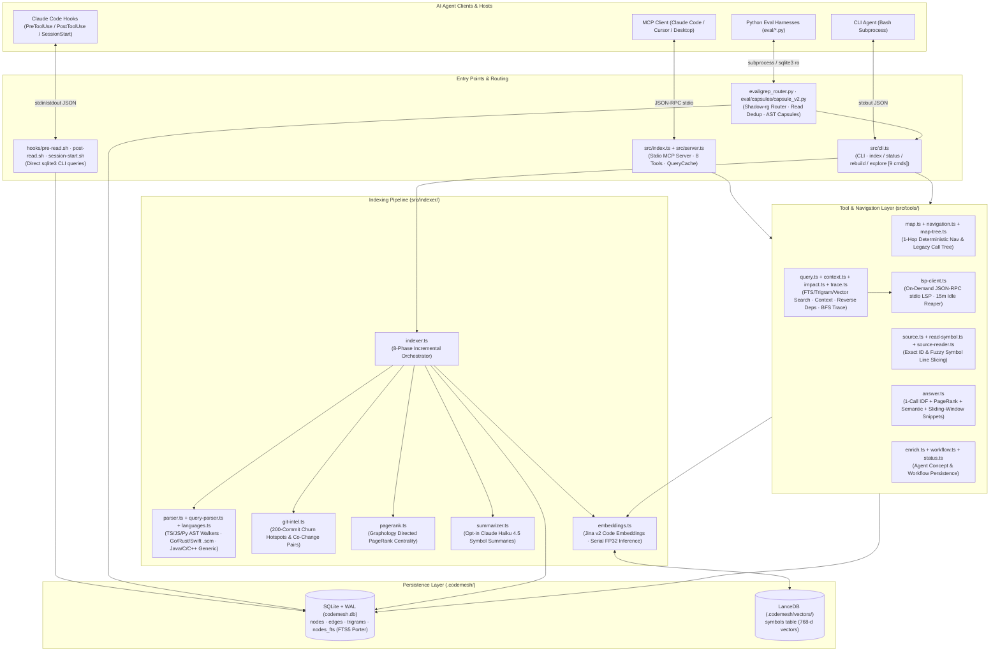
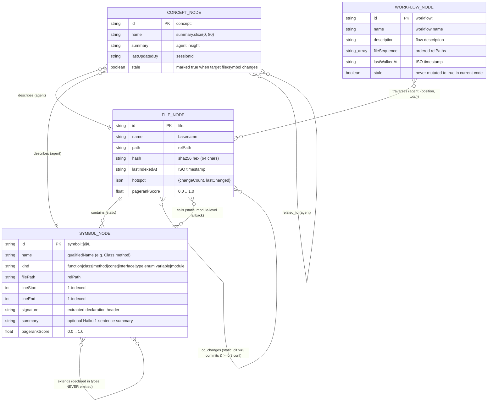
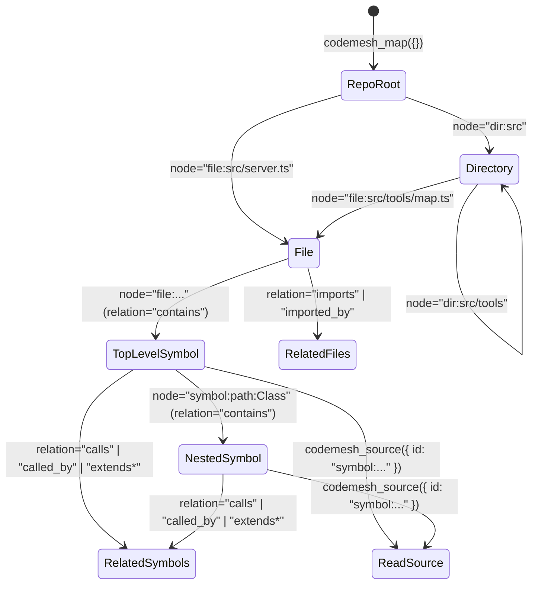
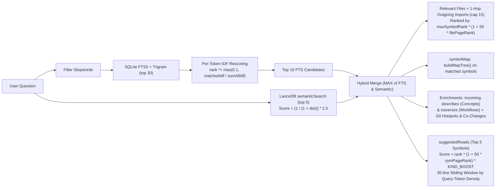
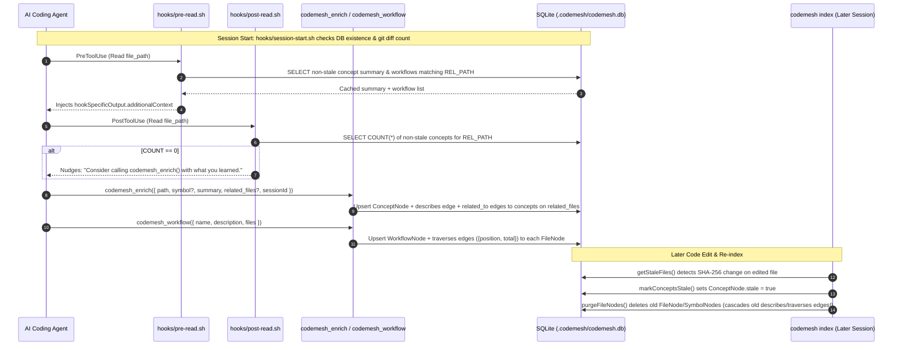

# Codemesh: Source-of-Truth Architecture, Modules & Workflows

> **Source-of-Truth Audit Note:** Derived directly from `src/`, `hooks/`, `skills/`, `scripts/`, and `eval/` as of v0.1.2 (`d1c37b5` + working tree). Where code diverges from `README.md` or `docs/v2-roadmap.md`, the actual implementation is documented and flagged.

---

## 1. System Topology & Layered Architecture



---

## 2. Module Inventory & Responsibility Matrix

| Layer | Module Path | Key Exports / Entry | Core Responsibility | Dependencies |
| :--- | :--- | :--- | :--- | :--- |
| **Entry** | [`src/index.ts`](../src/index.ts) | CLI bin / MCP boot | Resolves `CODEMESH_PROJECT_ROOT`, initializes `.codemesh/codemesh.db`, connects `StdioServerTransport`, registers `SIGINT`/`SIGTERM` LSP cleanup | `SqliteBackend`, `createServer`, `shutdownAllLspClients` |
| **Entry** | [`src/server.ts`](../src/server.ts) | `createServer()` | Registers **8 MCP tools**, wraps outputs with `{ projectRoot, ...data }`, caches `codemesh_answer` and legacy `codemesh_map` in `QueryCache` | `@modelcontextprotocol/sdk`, `zod`, `src/tools/*`, `QueryCache` |
| **Entry** | [`src/cli.ts`](../src/cli.ts) | `codemesh` bin | CLI router for `index`, `status`, `rebuild`, `explore` (**9 subcommands**), `version`, `help`; throttles stderr progress to 2s per phase | `Indexer`, `SqliteBackend`, `src/tools/*`, `semanticSearch` |
| **Cache** | [`src/cache/query-cache.ts`](../src/cache/query-cache.ts) | `QueryCache<T>` | 500-entry in-memory LRU cache keyed by `v{lastIndexedAt}:{tool}:{query.trim().toLowerCase()}` (auto-invalidates on re-index) | None |
| **Graph** | [`src/graph/types.ts`](../src/graph/types.ts) | `GraphNode`, `GraphEdge` | Defines 4 node types (`file`, `symbol`, `concept`, `workflow`), 9 symbol kinds, 8 edge types, and ` static \| agent` provenance | None |
| **Graph** | [`src/graph/storage.ts`](../src/graph/storage.ts) | `StorageBackend` | Storage abstraction interface for CRUD, batch path queries, BFS traversal, FTS/trigram search, transactions, and staleness maintenance | `src/graph/types.ts` |
| **Graph** | [`src/graph/sqlite.ts`](../src/graph/sqlite.ts) | `SqliteBackend` | Synchronous `better-sqlite3` WAL implementation with `nodes`, `edges` (`ON DELETE CASCADE`), `trigrams`, and `nodes_fts` (FTS5 Porter + sync triggers) | `better-sqlite3` |
| **Indexer** | [`src/indexer/indexer.ts`](../src/indexer/indexer.ts) | `Indexer` | 8-phase incremental indexing pipeline (`scan` → `purge` → `parse` → `resolve` → `summaries` → `git` → `pagerank` → `embeddings`) | `ignore`, `parser`, `git-intel`, `pagerank`, `summarizer`, `embeddings` |
| **Indexer** | [`src/indexer/languages.ts`](../src/indexer/languages.ts) | `getLanguageConfig()` | Maps **19 file extensions across 9 languages** to tree-sitter packages and optional `.scm` query files | None |
| **Indexer** | [`src/indexer/parser.ts`](../src/indexer/parser.ts) | `parseFile()` | Lazy grammar loader + dedicated AST walkers for TS/JS (`walkTS`), Python (`walkPython`), `.scm` dispatch, or generic fallback (`walkGeneric`) | `tree-sitter`, `languages.ts`, `query-parser.ts` |
| **Indexer** | [`src/indexer/query-parser.ts`](../src/indexer/query-parser.ts) | `parseWithQuery()` | Executes `.scm` captures (`@symbol.<kind>.name/node`, `@import.source`, `@call.callee`) for Go, Rust, Swift; computes container scope & promotes functions in containers to `method` | `tree-sitter`, `src/indexer/queries/*.scm` |
| **Indexer** | [`src/indexer/git-intel.ts`](../src/indexer/git-intel.ts) | `analyzeGitHistory()` | Parses last 200 commits via `git log --name-only` to compute file churn hotspots and pairwise co-change confidence ($\ge 3$ co-commits, confidence $\ge 0.3$) | `node:child_process` (`git`) |
| **Indexer** | [`src/indexer/pagerank.ts`](../src/indexer/pagerank.ts) | `computePageRank()` | Loads all `file` and `symbol` nodes + outgoing edges into `graphology` and computes unweighted PageRank centrality | `graphology`, `graphology-metrics` |
| **Indexer** | [`src/indexer/summarizer.ts`](../src/indexer/summarizer.ts) | `summarizeSymbols()` | Opt-in (`--with-summaries` + `ANTHROPIC_API_KEY`); batches symbols per file to `claude-haiku-4-5-20251001` for 1-sentence purpose summaries | `@anthropic-ai/sdk`, `source-reader.ts` |
| **Indexer** | [`src/indexer/embeddings.ts`](../src/indexer/embeddings.ts) | `indexEmbeddings()`, `semanticSearch()` | Local FP32 embeddings via `@huggingface/transformers` (`jinaai/jina-embeddings-v2-base-code`), stored in `.codemesh/vectors` LanceDB `symbols` table | `@huggingface/transformers`, `@lancedb/lancedb` |
| **Tools** | [`src/tools/map.ts`](../src/tools/map.ts) | `handleMap()` | Dual-mode router: delegates to `handleNavigation` (deterministic 1-hop) when `query`/`symbol` omitted, or builds legacy call tree via `buildMapTree` | `navigation.ts`, `map-tree.ts`, `trace.ts`, `embeddings.ts` |
| **Tools** | [`src/tools/navigation.ts`](../src/tools/navigation.ts) | `handleNavigation()` | Bounded, cursor-paginated 1-hop expansion over `repo`, `dir:<path>`, `file:<path>`, `symbol:<path>:<qualifiedName>`, and 6 relations | `StorageBackend` |
| **Tools** | [`src/tools/map-tree.ts`](../src/tools/map-tree.ts) | `buildMapTree()` | Unbounded visited-set BFS over outgoing `calls` edges + up to 8 immediate incoming `calledBy` callers per symbol | `StorageBackend` |
| **Tools** | [`src/tools/source.ts`](../src/tools/source.ts) | `handleSource()` | Exact symbol ID lookup (`symbol:<path>:<qualifiedName>`) returning disk lines `lineStart..lineEnd` | `source-reader.ts` |
| **Tools** | [`src/tools/read-symbol.ts`](../src/tools/read-symbol.ts) | `handleReadSymbol()` | CLI-only (`codemesh explore read <symbol>`) fuzzy symbol lookup via `findSymbol` + disk source read | `trace.ts`, `source-reader.ts` |
| **Tools** | [`src/tools/answer.ts`](../src/tools/answer.ts) | `handleAnswer()` | One-call context assembly combining LanceDB vector search, stopword-filtered FTS5 + per-token IDF rescoring, PageRank + kind boosting, 1-hop imports, call tree, concepts, workflows, and 30-line token-dense sliding window snippets | `embeddings.ts`, `map-tree.ts` |
| **Tools** | [`src/tools/query.ts`](../src/tools/query.ts) | `handleQuery()` | Scoped search (`files \| symbols \| workflows \| all`), PageRank-sorted (top 20) + up to 10 deduplicated semantic vector matches | `embeddings.ts` |
| **Tools** | [`src/tools/context.ts`](../src/tools/context.ts) | `handleContext()` | Single or multi-path (`paths[]`) metadata aggregator: symbols, 5-hop outgoing `callChain`, LSP `definedAt`/`referencedBy`, `imports`/`importedBy`, `concepts`, `workflows`, `hotspot`, `coChanges` | `lsp-client.ts` |
| **Tools** | [`src/tools/impact.ts`](../src/tools/impact.ts) | `handleImpact()` | Reverse-dependency lookup (all incoming edges to a file or fuzzy-matched symbol within a file), sorted by PageRank | `StorageBackend` |
| **Tools** | [`src/tools/trace.ts`](../src/tools/trace.ts) | `handleTrace()`, `findSymbol()` | 3-strategy symbol resolver + BFS outgoing `calls` traversal (default depth 5 in MCP, 3 in handler/CLI), returning source (or line ranges in `--compact` mode) sorted by PageRank | `source-reader.ts` |
| **Tools** | [`src/tools/enrich.ts`](../src/tools/enrich.ts) | `handleEnrich()` | Agent write-back: creates `ConceptNode`, `describes` edge to target file/symbol, and `related_to` edges to existing concepts on `related_files` | `StorageBackend` |
| **Tools** | [`src/tools/workflow.ts`](../src/tools/workflow.ts) | `handleWorkflow()` | Agent write-back: upserts `WorkflowNode` (`workflow:<slug>`) and positional `traverses` edges (`{ position, total }`) to each existing `FileNode` | `StorageBackend` |
| **Tools** | [`src/tools/lsp-client.ts`](../src/tools/lsp-client.ts) | `getLspClient()` | Spawns & caches `typescript-language-server`, `pyright-langserver`/`pylsp`, or `sourcekit-lsp` over stdio JSON-RPC; reaps idle servers after 15 min | `node:child_process` |
| **Hooks** | [`hooks/*.sh`](../hooks/) | `pre-read.sh`, `post-read.sh`, `session-start.sh` | Non-blocking (`exit 0`) bash hooks querying `.codemesh/codemesh.db` via `sqlite3` CLI to inject summaries/workflows before `Read`, nudge `codemesh_enrich` after `Read`, and warn on git drift at session start | `sqlite3`, `python3`, `git` |
| **Scripts** | [`scripts/check-integrity.ts`](../scripts/check-integrity.ts) | `npm run check:integrity` | Validates 0 dangling edge endpoints, 0 orphan symbols without `contains` edges, and `id == 'file:' \|\| path` invariants | `SqliteBackend` |
| **Eval** | [`eval/grep_router.py`](../eval/grep_router.py), [`eval/capsules/`](../eval/capsules/) | `route_grep()`, `ReadRouter`, `capsule_v2` | Experimental Python harness routers for SHA-256-verified grep declaration annotation, AST return-delegate tails, repeat-read deduplication, and syntactic code capsules | `sqlite3`, `ast`, `rg` |

---

## 3. Graph Data Model & Storage Schema



### Physical Storage Layout (`.codemesh/`)

```
.codemesh/
├── codemesh.db              # SQLite database (WAL mode, foreign_keys = ON)
│   ├── nodes                # (id PK, type, source, name, path, hash, data JSON, created_at, updated_at)
│   ├── edges                # (id PK, type, source, from_id FK->nodes ON DELETE CASCADE, to_id FK->nodes ON DELETE CASCADE, data JSON, created_at)
│   ├── trigrams             # (trigram, node_id) — 3-char lowercase substrings of symbol "name signature"
│   └── nodes_fts            # FTS5 virtual table (node_id UNINDEXED, name, signature, summary, description, tokenize='porter') + AFTER INSERT/UPDATE/DELETE triggers
└── vectors/                 # LanceDB directory (created by indexEmbeddings)
    └── symbols.lance/       # Arrow/Lance table: { id, name, signature, filePath, text, vector: float32[768] }
```

---

## 4. Complete Catalog of Existing Workflows (Code as Source of Truth)

### Workflow 1: 8-Phase Incremental Indexing Pipeline (`codemesh index` / `codemesh rebuild`)

Triggered via `codemesh index [--with-embeddings] [--with-summaries]` or `codemesh rebuild` (which deletes `.codemesh/` first).

```mermaid
sequenceDiagram
    autonumber
    participant CLI as src/cli.ts
    participant Idx as Indexer (indexer.ts)
    participant FS as Filesystem / Git
    participant Parser as Parser / .scm / Walkers
    participant SQLite as SqliteBackend (codemesh.db)
    participant AI as Haiku API / Local Jina Model
    participant Lance as LanceDB (.codemesh/vectors)

    CLI->>Idx: index({ withEmbeddings, withSummaries, onProgress })
    
    rect rgb(235, 245, 255)
    Note over Idx,FS: Phase 1: SCAN & DIFF
    Idx->>FS: Load .gitignore + ALWAYS_IGNORED (node_modules, .git, .codemesh, dist, build, __pycache__)
    Idx->>FS: Recursive walk & SHA-256 hash every supported file (19 extensions)
    Idx->>SQLite: getStaleFiles(fileHashes) -> { changed, deleted, added }
    end

    rect rgb(255, 240, 240)
    Note over Idx,SQLite: Phase 2: STALENESS & PURGE (Transaction A)
    Idx->>SQLite: markConceptsStale([...changed, ...deleted]) (batches of 500)
    Idx->>SQLite: purgeFileNodes([...changed, ...deleted]) (deletes symbols & files; cascades edges)
    end

    rect rgb(240, 255, 240)
    Note over Idx,SQLite: Phase 3: SEED & BATCH PARSE (Transaction B · 500 files/tx)
    Idx->>SQLite: Load existing SymbolNodes from unchanged files into symbolNameMap
    loop Every 500 files in [...changed, ...added]
        Idx->>Parser: parseFile(absPath, relPath)
        Parser-->>Idx: { symbols, imports, calls }
        Idx->>SQLite: Upsert FileNode + SymbolNodes (collision suffix @L<line>) + contains edges + trigrams + FTS5
    end
    end

    rect rgb(255, 250, 230)
    Note over Idx,SQLite: Phase 4: GRAPH EDGE RESOLUTION (Transaction C)
    Idx->>SQLite: Pass 2 — Resolve relative imports ("./", "../") -> upsert imports edges
    Idx->>SQLite: Pass 3 — Resolve calls (this.<method> scope walk or bare name) + smallest containing callable range -> upsert calls edges
    end

    opt Phase 5: Symbol Summarization (--with-summaries & ANTHROPIC_API_KEY)
        Idx->>AI: Group symbols by file -> claude-haiku-4-5-20251001 (JSON array of 1-sentence summaries)
        Idx->>SQLite: Upsert SymbolNode.summary (triggers FTS5 re-index)
    end

    rect rgb(245, 240, 255)
    Note over Idx,SQLite: Phase 6: GIT INTELLIGENCE (Non-fatal)
    Idx->>FS: git log --name-only -n 200
    Idx->>SQLite: Upsert FileNode.hotspot & co_changes edges (coChangeCount >= 3 & confidence >= 0.3)
    end

    rect rgb(240, 250, 250)
    Note over Idx,SQLite: Phase 7: PAGERANK CENTRALITY (Non-fatal)
    Idx->>SQLite: Load all file & symbol nodes + outgoing edges into Graphology
    Idx->>SQLite: Compute PageRank & batch-update node.pagerankScore
    end

    opt Phase 8: Semantic Embeddings (Indexer default=true; CLI requires --with-embeddings)
        Idx->>Lance: deleteEmbeddingsByFilePaths([...changed, ...deleted]) (chunks of 5000)
        Idx->>AI: Build text ([module]\nname sig\nsummary|30 source lines) -> serial FP32 Jina embedding (batches of 256)
        Idx->>Lance: createTable / mergeInsert("id") into symbols table
    end
```

#### Language Parsing Dispatch Matrix (`src/indexer/languages.ts` + `parser.ts`)

```
File Extension
  ├── .ts, .tsx, .js, .jsx, .mjs, .cjs ──► walkTS() [Hand-written AST walker]
  │     Extracts: function, class, method (scopePath), interface, type, enum, const, import_statement, call_expression, new_expression
  ├── .py, .pyi ─────────────────────────► walkPython() [Hand-written AST walker]
  │     Extracts: function, class, method (when scopeStack > 0), import/from_import, call (identifier / attribute)
  ├── .go, .rs, .swift ──────────────────► parseWithQuery() [Tree-sitter .scm query engine]
  │     Uses: go.scm / rust.scm / swift.scm -> container range scope inference -> promotes functions in containers to "method"
  ├── .java, .c, .h, .cpp, .cc, .cxx, .hpp, .hh ► walkGeneric() [Fallback AST walker]
  │     Extracts: top-level function & class/struct names ONLY (0 imports, 0 calls, empty scopePath)
  └── .cs, .rb, .php, .kt, .dart ────────► IGNORED (Not in LANGUAGE_CONFIGS despite README/package.json)
```

---

### Workflow 2: Deterministic 1-Hop Map Navigation (`codemesh_map` / `codemesh explore map`)

The primary v2 navigation loop instructed by [`skills/codemesh.md`](../skills/codemesh.md). Returns bounded, cursor-paginated metadata (default `limit: 30`, max `100`) with **zero source code bodies**.


*\*Note: `relation="extends"` is accepted by schema validation but always returns `[]` because no parser emits `extends` edges.*

---

### Workflow 3: Legacy Query/Symbol Call-Tree Mapping (`codemesh_map({ query | symbol })`)

Available via **MCP only** (`cli.ts` `parseMapArgs` only accepts `--node`, `--relation`, `--limit`, `--cursor`). Cached in `QueryCache`.

```
codemesh_map({ query, symbol })
  ├─ If symbol provided: findSymbol(storage, symbol) ──► top 3 symbol IDs
  ├─ If query provided:
  │    ├─ storage.search(query, "symbols") [FTS5 + trigram] ──► top 5 symbol IDs
  │    └─ semanticSearch(projectRoot, query, 5) [LanceDB]   ──► top 5 deduplicated IDs
  │    └─ Merge & cap at 5 starting symbol IDs
  └─ buildMapTree(storage, startNodeIds)
       ├─ Unbounded recursive DFS/visited-set walk over outgoing `calls` edges
       └─ Attaches up to 8 immediate incoming `calledBy` callers per node
```

---

### Workflow 4: One-Call Ranked Context Assembly (`codemesh_answer` / `codemesh explore answer`)

Assembles a complete context package for a natural-language question in one call (cached in MCP via `QueryCache`).



---

### Workflow 5: Omni-Tool Exploration (`codemesh_explore` / `codemesh explore <search|context|impact>`)

Consolidates three distinct retrieval workflows under a single MCP schema (and 3 CLI subcommands):

```
codemesh_explore
 │
 ├── action: "search" (src/tools/query.ts)
 │     1. storage.search(query, scope) ──► FTS5 Porter BM25; if < 5 hits, augments with Trigram search (match_ratio >= 0.6)
 │     2. Filter by scope ("files" | "symbols" | "workflows" | "all")
 │     3. Sort primarily by node.pagerankScore DESC, tie-break by FTS rank (cap 20)
 │     4. Run LanceDB semanticSearch(query, 10), deduplicate against FTS hits, return in `semanticResults`
 │
 ├── action: "context" (src/tools/context.ts) — supports single `path` or batch `paths[]`
 │     1. Resolve FileNode(s) and outgoing `contains` SymbolNodes (optional substring filter on `symbol`)
 │     2. For each symbol: collect 1-hop `calls`, 1-hop `calledBy`, and 5-hop BFS `callChain`
 │     3. Optional LSP Enhancement (src/tools/lsp-client.ts):
 │          - Spawns typescript-language-server / pyright-langserver / pylsp / sourcekit-lsp if on PATH
 │          - If `symbol` filter matched multiple candidates: disambiguates via `textDocument/definition`
 │          - Enriches each symbol with `definedAt` {uri, line, character} and `referencedBy` count
 │     4. Collect file `imports`, `importedBy`, `concepts` (file + symbol level), `workflows`, `hotspot`, `coChanges`
 │     5. If `paths[]` provided: merges and deduplicates all arrays via `mergeContextResults()`
 │
 └── action: "impact" (src/tools/impact.ts)
       1. Target `file:<path>` or fuzzy-matched `symbol` inside that file
       2. Fetch all incoming edges (`direction = "in"`) of any type (`imports`, `calls`, `describes`, `traverses`, `co_changes`)
       3. Deduplicate source nodes and sort by `pagerankScore DESC`
```

---

### Workflow 6: Call-Chain Tracing & Source Reading (`trace`, `source`, `read`)

Three complementary ways to inspect symbol source code:

| Workflow | Entry Point | Resolution Strategy | Traversal | Source Returned |
| :--- | :--- | :--- | :--- | :--- |
| **Exact Symbol Read** | MCP `codemesh_source` / CLI `explore source <id>` | Exact primary key lookup (`storage.getNode(id)`) | None (single node) | Full lines `lineStart..lineEnd` from disk |
| **Fuzzy Symbol Read** | CLI-only `codemesh explore read <symbol>` | `findSymbol()` 3-stage fallback: 1. Exact `name` → 2. `Class.method` file-scoped split → 3. Top-3 FTS search | None (first match) | Full lines `lineStart..lineEnd` from disk |
| **Call-Chain Trace** | MCP `codemesh_trace` (depth=5) / CLI `explore trace <symbol> [--depth N] [--compact]` | `findSymbol()` 3-stage fallback on start symbol | BFS over outgoing `calls` edges up to `depth`, then **re-sorted by `pagerankScore DESC`** | Full symbol source per step (or line ranges only when `--compact` is passed) |

---

### Workflow 7: Cross-Session Agent Write-Back & Hook Interception Loop

How agent knowledge persists across sessions and surfaces automatically via Claude Code hooks:



---

### Workflow 8: Experimental Eval & Router Workflows (`eval/`)

In addition to the core TypeScript package, the repository implements three experimental Python workflows in `eval/` used to benchmark next-generation agent patterns:

```mermaid
flowchart TB
    subgraph RoutedWorkflow["1. Shadow-Native Grep & Numbered Read Router (eval/grep_router.py)"]
        GrepCall["Agent calls grep(query)"] --> ShadowRG["Run native rg --fixed-strings"]
        GrepCall --> DeclCheck{"Matches def/class\nor identifier?"}
        DeclCheck -->|Yes| HashVerify["Verify indexed file SHA-256 == disk SHA-256\n& check parity with rg lines"]
        HashVerify -->|Parity OK| Annotate["Append [codemesh-id | span | AST return L.. delegate & bindings]"]
        DeclCheck -->|No / Stale| NativeOut["Return native rg output unchanged"]

        ReadCall["Agent calls read(path, start, limit)"] --> ReadHash["Verify file SHA-256 vs codemesh.db"]
        ReadHash -->|Same span read in session| DedupStub["Return [Unchanged since read N: sha256...] stub"]
        ReadHash -->|Slice ends before function return| TailHint["Append [Codemesh verified tail: return L.. delegate]"]
    end

    subgraph CapsuleWorkflow["2. Query-Aware Code Capsules (eval/capsules/capsule_v2.py)"]
        PyAST["Python AST Extractor (CallCollector)"] --> Extract["Extract docstrings, guarded calls, guarded assignments, guarded raises"]
        Extract --> RankEv["Select top query-matching lines by word overlap / inverse frequency"]
        RankEv --> FormatCap["Render v2 / v2_ids (U1..Un unit aliases, E1..En evidence aliases)\n+ NEED_SOURCE:<id> fallback"]
    end

    subgraph RepairHarness["3. 3-Phase Handoff & Repair Evaluation (eval/edit_workflow_eval.py)"]
        P0["Phase 0: Symptom Investigation\n(Read >= 1 span, no edits)"] --> P1["Phase 1: Impact Question\n(Inspect callers/guards)"]
        P1 --> Compaction["Compaction Turn: Write <=120-word Handoff Memory"]
        Compaction --> P2["Phase 2 (Fresh Session + Reset Dedup):\nApply exact-string edit + run visible pytest + hidden pytest audit"]
    end
```



---

## 5. Source-of-Truth Discrepancies & Architectural Gaps (Input for Next Version)

| # | Area | What Docs / Types Claim | Actual Code Behavior (Source of Truth) | Impact for Next Version |
| :- | :--- | :--- | :--- | :--- |
| **1** | **CLI vs. MCP Tool Parity** | `README.md` says CLI mode supports `codemesh enrich ...` and lists 8 tools across MCP and CLI. | `src/cli.ts` has **no `enrich` or `workflow` commands** (they are MCP-only). Conversely, `explore read` and `explore semantic` exist **only in CLI**, not as standalone MCP tools. | Expose `enrich` and `workflow` in `cli.ts`, and decide whether `read` / `semantic` should be exposed or unified in MCP. |
| **2** | **Language Coverage Gap** | `README.md` lists 14 languages; `package.json` bundles 13 `tree-sitter-*` packages. | `src/indexer/languages.ts` only registers **9 languages**. C#, Ruby, PHP, Kotlin, and Dart are ignored. Java, C, and C++ use `walkGeneric()` which extracts **0 imports and 0 call edges**. | Register C#, Ruby, PHP, Kotlin in `languages.ts` and add `.scm` query files for Java, C, C++, C#, Ruby, PHP, Kotlin. |
| **3** | **`.tsx` Grammar Bug** | `languages.ts` maps `.tsx` to `name: "typescript"`. | In `src/indexer/parser.ts:56`, `loadGrammar` checks `if (languageName === "tsx")`, which is **unreachable** because `config.name` is always `"typescript"`. `.tsx` files are parsed with the non-JSX TypeScript grammar, causing syntax errors on JSX elements. | Split `.tsx` into its own `LanguageConfig` with `name: "tsx"` (or pass file extension to `loadGrammar`). |
| **4** | **Relative-Only Import Resolution** | Graph edges represent file-to-file `imports`. | `Indexer.resolveImportPath()` returns `null` unless `importPath.startsWith(".")`. All Python imports (`from pkg.mod import x`), Go/Rust/Swift module imports, and TS path aliases (`@/foo`) produce **zero `imports` edges**. | Add language-aware module resolution (Python dotted paths, TS `tsconfig.json` `paths`, Go/Rust module paths). |
| **5** | **Dead `extends` Edge Type** | `EdgeType` includes `"extends"`, and `codemesh_map` exposes `relation: "extends"`. | **No parser or indexer pass ever creates an `extends` edge.** Querying `relation: "extends"` always returns `[]`. | Extract class inheritance / interface implementation in `parser.ts` and `.scm` queries and emit `extends` edges in Pass 2/3. |
| **6** | **Cascade Deletion Orphans Concepts & Workflows** | `README.md` says enrichments and workflows survive re-indexing and only go stale when files change. | In `sqlite.ts`, `edges` has `ON DELETE CASCADE`. When a changed file is re-indexed, `purgeFileNodes()` `DELETE`s the old `FileNode` and `SymbolNode`s before re-inserting them—**cascade-deleting all incoming `describes` and `traverses` edges!** Stale concepts remain in `nodes` but lose their graph edges, and `WorkflowNode.stale` is never set to `true`. | Replace `DELETE` + `INSERT` in `purgeFileNodes` with targeted symbol diffing, or preserve/re-bind incoming `describes` and `traverses` edges across file re-indexing. |
| **7** | **Embeddings Default Mismatch** | `README.md` and `cli.ts` state embeddings are opt-in via `--with-embeddings`. | `Indexer.index()` runs embeddings when `options?.withEmbeddings !== false` (opt-out by default in API), whereas `cli.ts` passes `args.includes("--with-embeddings")` (opt-in in CLI). | Align `Indexer.index()` default with CLI (`Boolean(options?.withEmbeddings)`). |
| **8** | **Trace Ordering vs. Execution Order** | `codemesh_trace` is described as following an execution call chain from a starting symbol. | `handleTrace()` performs BFS over `calls` edges, **then sorts `steps` by `pagerankScore DESC`**, scrambling the chronological/BFS call depth order and omitting `depth` from each step. | Preserve BFS `depth` and parent->child order in `TraceStep` (or offer PageRank as a secondary sort within each depth level). |
| **9** | **Full-File SHA-256 Read on Every Index** | `docs/v2-roadmap.md` lists `fs.stat` (`mtimeMs + size`) fast-path as Phase 1a. | `Indexer.walkDirectory()` still calls `readFileSync` + SHA-256 on every file in the repo on every `codemesh index` run. | Store `mtimeMs` and `size` on `FileNode` to skip reading unchanged files during incremental indexing. |
