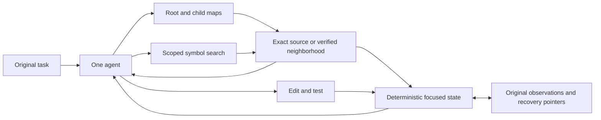

# Deterministic retrieval and context retention

Implemented 19 October 2026, returning to the Graphify discussion before the
decision-model pilot. The selector experiment is parked with its traces intact.
The normal MCP/CLI does not call a selection model. The evaluation harness uses
one requested reasoning model, currently Terra.

## Flow



The agent chooses branches, symbols and reads. The harness controls which prior
messages are retained. CodeMesh supplies structural retrieval, exact source and
freshness information. MCP responses cannot remove a client's previous messages;
other clients need a context-management adapter to adopt focused retention.

## Implemented findings

### Find the intended symbol

- Exact IDs and qualified names come first, followed by exact leaf names such as
  `get_default` matching `FieldInfo.get_default`.
- Other candidates rank by distinct query-term coverage, lexical relevance, and
  deterministic tie breaks. Popularity cannot displace an exact declaration.
- File/directory filters apply inside SQLite before FTS/trigram candidate caps,
  with path-boundary matching and separately keyed caches.
- Legacy query-driven map seeds use the same ranking as search.

```sh
codemesh explore search get_default --path pydantic --scope symbols --limit 5 --compact
```

### Inspect the relevant relationship

`inspect --direction outgoing|incoming|both` returns the root first and bounded
whole source blocks for neighbors. Incoming graph links nominate candidates;
current Python call binding must prove the exact target before a caller is
included. Output preserves actual caller → callee direction and identifies the
neighbor source block. Source and binding dependencies are checked for changes.

```sh
codemesh explore inspect 'symbol:pkg/core.py:resolve_default_value' \
  --direction both --max-candidates 16 --max-symbols 4 --max-bytes 24576
```

Caller verification defaults to 32 candidates, capped at 128. Source count and
the entire serialized response remain bounded. Missing, ambiguous, stale and
omitted information stays explicit. Incoming discovery always says
`complete:false`: missing graph edges, especially aliases, can hide callers.
This implementation does not scan every source file to manufacture completeness.
Other-language relationships remain unverified; static bindings do not guarantee
all runtime behavior. Community maps and multi-hop path exploration remain later
work.

### Keep context compact without another model

The new `FocusedWorkingState` extends the existing evidence lifecycle:

- Original task and exact source precede changing navigation/archive metadata.
- Identical successful navigation requests collapse into recoverable pointers;
  changed results are delivered again. Different branches remain alternatives.
- Compact root orientation and pending pagination are retained independently of
  ordinary recent ledger entries. Hard budget omissions are explicit and the
  archive index remains available.
- Exact source keeps its existing 16 KiB retention budget, hash authority and
  edit invalidation. Tasks, current phase, unverified model notes, edits, tests and
  relevant errors remain visible. Archived code requires a live read.
- No selector prompts, confidence fields, repeated retention rationales, or
  extra model handoff are introduced.

Map/search also have an 8 KiB serialized JSON budget, adjustable from 512 to
65536 bytes. They omit whole records. A navigation cursor identifies the first
unreturned entry; if it cannot fit alone, the response asks for a larger budget.
MCP and CLI preserve these bounds and omission metadata.

## Verification

- TypeScript build passed; all **265 TypeScript tests** passed.
- Focused context, evidence, handoff, harness and replay gates: **139 Python tests** passed.
- [Public CLI contract](../../eval/results/graphify-deterministic-2026-10-19/CLI_CONTRACT.json):
  real indexing → root/child maps → scoped exact-leaf search → verified caller
  and callee source; after an edit, the stale caller is excluded. No graph edges
  were inserted by the test to make discovery succeed.
- [Fixed-trajectory replay](../../eval/results/graphify-deterministic-2026-10-19/replay/slim/REPORT.md)
  records exact prompts, byte counts, prefix behavior and preservation checks.

Across 12 saved calls from two tasks, focused state used **56,711 input bytes**
versus **55,379** for the established working state (**2.41% more**). A synthetic
journey with repeated navigation used **6.29% fewer bytes** across 19 diagnostic
checkpoints. Source retention and protected task/edit/test fields matched the
baseline at every checkpoint. The initial presentation added 20.00% on the real
controls; its [pre-slim replay](../../eval/results/graphify-deterministic-2026-10-19/replay/REPORT.md)
is preserved. Removing redundant metadata reduced that overhead. The
[comparison](../../eval/results/graphify-deterministic-2026-10-19/replay/COMPARISON.md)
records both versions and their measurement limits.

These implementation checks establish behavior and context contents. Replay byte
changes are not model token savings. The subsequent live run is summarized below.

### Live Terra follow-up

The [36-trajectory evaluation](../../eval/results/graphify-terra-2026-10-19/REPORT.md)
is complete: filesystem versus CodeMesh, working-set versus focused retention,
three Pydantic tasks and three repeats. First-patch acceptance, final hidden-test
acceptance and workflow completion were 9/9 in every cell.

With the established working state, CodeMesh delivered 61.0% less source text,
but used 8.0% more total input tokens than filesystem retrieval. Uncached input
was 38.6% lower; billed dollar cost was unavailable. Focused retention increased
CodeMesh input tokens by 6.3% and model time by 16.0%, with unchanged acceptance.
The existing working state remains the default.

Two interrupted transport attempts were retained and retried. The
[integrity audit](../../eval/results/graphify-terra-2026-10-19/VALIDATION.json)
verified all 382 recorded calls and 1,874 input artifacts. Caller traversal was
not selected in these runs; these three small tasks do not validate its benefit
or establish performance on longer graph-navigation workflows. See
[findings](../../eval/results/graphify-terra-2026-10-19/FINDINGS.md) for the prompt
overhead and search-detour evidence.

## Evaluation entry point

`eval/vnext_agent.py` defaults to `--model gpt-5.6-terra --context-policy working-set`.
The new `focused` policy is opt-in until a live comparison supports switching.
Both filesystem and CodeMesh arms use the same context policy. The original
`working-set` and `full` remain explicit controls; hydration and bundled reads
remain independently optional. `--bundle-reads` exposes directional inspection
and equivalent explicit filesystem batch reads. Graph improvements and retention
should be evaluated separately before combining them.

```sh
# Preparation only; add --run when starting a new live comparison.
python3 eval/vnext_agent.py --repo /tmp/codemesh-pydantic-benchmark \
  --model gpt-5.6-terra --context-policy focused \
  --out eval/results/graphify-focused-new

# Public CLI correctness check; no model calls.
python3 eval/graphify_contract.py
```

## Design reference

We inspected Graphify at commit `86c57be8204673c2a1b9849a3292a7dd3ab373d8`.
The relevant ideas were ranked starting symbols, directional traversal, limited
neighborhoods and compact output. See its
[retrieval implementation](https://github.com/Graphify-Labs/graphify/blob/86c57be8204673c2a1b9849a3292a7dd3ab373d8/graphify/serve.py).
The implementation here extends CodeMesh's existing storage, resolver and state
code. No Graphify source was copied and no vector database was added.
