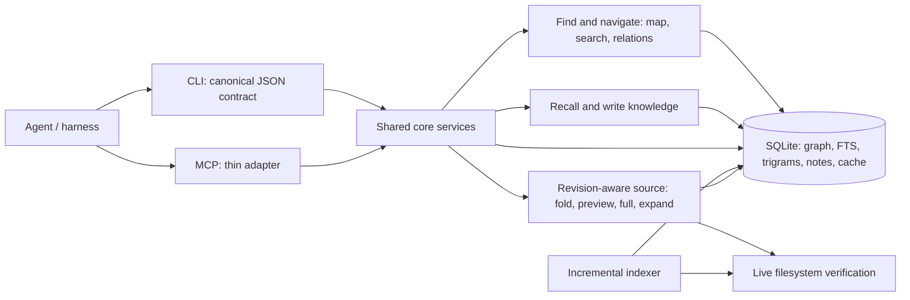

# Codemesh vNext: a versioned code context layer

**Planning date:** 2026-10-18  
**Status:** Core CLI/MCP implementation in the working tree; hooks deferred  
**Input:** User-provided *Code Mesh Deep Research Comparative Analysis, Literature Review, and Agent Caching Architecture* PDF, checked against the current working tree.

## Goal

Make Codemesh the durable, deterministic layer that an agent can use to locate, inspect, and remember code across turns and sessions. The agent should ask for the smallest useful unit of source, know whether that unit changed, and recover exact bytes whenever needed. Codemesh should retain structural facts and attributed notes while the harness retains its own conversation memory.

Success means less repeated **source delivery and rediscovery** during real coding work, without stale code, broken references, or extra tool loops that erase any saving. It does not require the agent to choose Codemesh for every read.

## Current baseline and corrections to the research

- The repository already has SQLite FTS/trigrams, a symbol graph, optional LanceDB embeddings, `codemesh_map` one-hop navigation with stable-looking IDs and pagination, `codemesh_source`, `answer`, `explore`, `trace`, and agent-written concepts/workflows.
- The current indexer reads and SHA-256 hashes source files during its scan; it does **not** currently use only `mtime:size` as the PDF states. The existing `getStaleFiles` compares those hashes.
- `codemesh_map` has a bounded deterministic navigation path. Its older query/symbol call-tree path and `codemesh_answer` still call `buildMapTree`, which has no depth or node budget.
- `codemesh_source` reads live disk bytes using line ranges from the index. If source changed after indexing, those ranges can point to the wrong code. This is a correctness issue to fix before source reuse.
- The in-memory `QueryCache` covers only `answer` and legacy `map`, is lost across CLI processes, and invalidates on any index timestamp change. Agent notes are appended as concepts, without consolidation or reliable target revision binding.
- Hook scripts now emit structured hook context, but remain advisory and do not track delivered source spans. The research describes an older hook snapshot. The published package is `0.1.2`; “vNext” here is an architecture label, not a package-version promise.

Historical evaluations remain in `docs/experiments/` as an archive. Their percentages, and the PDF's projected percentages, are hypotheses rather than release promises. The new design should be judged by correctness contracts and live use, with lightweight telemetry to expose whether it helps.

## Agreed deployment choices

- **Client agnostic core:** one set of TypeScript services implements indexing, navigation, exact source reads, memory, and caching. The CLI is the deterministic reference interface and emits stable JSON. The MCP server is a thin adapter over those same services; neither owns separate retrieval logic.
- **One database:** `.codemesh/codemesh.db` is the durable store for graph facts, FTS/trigram search, knowledge, retrieval cache, and optional delivery records. No vector database or embedding model is required for vNext. The existing LanceDB data is derived and can be left untouched during migration, then retired after the SQLite-only path is verified. Never delete the user's concepts or workflows during this migration.
- **Hooks later:** first demonstrate that an agent deliberately using CLI/MCP navigation gets correct, compact context. Then build harness-specific hooks that intercept native tool inputs/outputs and route safe cases through the same core. Hooks are adapters that encourage or automate deterministic use, not a hidden dependency of the core.

SQLite already supports the needed text and graph primitives: exact indexed IDs, FTS5/BM25, a trigram table, indexed edges, and bounded traversals. The main tradeoff without embeddings is weaker recall when a question uses words absent from code names or stored notes. Address that with indexed aliases, summaries, paths, signatures, and agent knowledge; give the agent a way to broaden or navigate from a lexical miss. Do not promise semantic equivalence from SQLite text search alone. If real use later shows a meaningful recall gap, an optional semantic adapter can be added without changing the source/graph contracts.

Search order: exact ID/path/symbol lookup → normalized identifier and trigram match → FTS5 over names, signatures, summaries, aliases, and notes → bounded graph expansion from matches. Return why each result matched. When there is no confident match, return nearby directories and candidate search terms rather than inventing a semantic hit. SQLite WAL supports concurrent readers and a writer, but indexing and note writes still need a short transaction and busy-timeout policy.

## Proposed architecture

### Three different kinds of state

1. **Structural graph:** extracted facts (file/symbol identity, exact spans, imports, calls) with source revision, extraction method, and confidence. This is rebuilt from code and is never overwritten by an agent summary.
2. **Knowledge store:** human/agent explanations, decisions, workflows, and unresolved hypotheses, each bound to source IDs and revisions with author/session and time. Contradictory or stale notes remain visible as such instead of being silently treated as facts.
3. **Reuse state:** a persistent cache of deterministic retrieval work, plus a session delivery ledger where the host supplies a reliable session/context identity. Reuse state is disposable and can always be recomputed from source and the graph.

### The source contract

Every returned source unit carries `{id, path, span, sourceHash, indexRevision, freshness}`. A unit ID identifies a symbol or span; `sourceHash` identifies its exact bytes. Stable identity and content revision are separate. IDs may be short in agent-facing output, but `codemesh_source` must resolve them to a readable path and byte-exact code.

`codemesh_source` accepts a detail level (`fold`, `preview`, `full`), an optional `ifHash`, and `force`. With a matching `ifHash`, it can return `unchanged` plus the source reference. Without `ifHash`, it returns source according to the requested level. An `expand(ref)` operation always returns exact current bytes, or an explicit changed/deleted result. The server never assumes that a previous excerpt survived compaction or is present in another agent's context.

Before returning indexed line ranges, Codemesh verifies the file revision against disk. On mismatch it refreshes that file before reading or returns a clear stale result and a live-path fallback. It must never silently attach an old symbol ID to new lines.

### Agent flow

1. Agent calls `map` at repository or directory level, or uses `explore search` for an entry point. Results are bounded and contain names, signatures, relation types, IDs, and freshness, with no large source payload.
2. Agent expands a selected file/symbol or one-hop relation. Structural edges distinguish extracted, resolved, and uncertain links.
3. Agent calls `source` for the exact unit and desired detail. Full source is readily available when editing; previews declare omitted ranges.
4. A later read can send `ifHash`; an unchanged response avoids resending bytes. A host adapter may do this automatically only when it knows the prior content is still in the active model context. After compaction or a new session, the caller requests source again as needed.
5. Agent writes a note or workflow tied to current source revisions. Future sessions recall that note as a navigation clue, verify its source, and fetch exact code only when needed.

## Delivery plan

| Phase | Work | Reviewable result / acceptance |
|---|---|---|
| **1. SQLite-only reference path and correct revisions** | Put CLI and MCP over shared services; make CLI output machine-readable. Remove vector search from the vNext default path. Add schema migration, per-symbol body/signature hashes, file revision and extraction metadata; preserve unchanged symbol summaries when other code in a file changes. Make `source` check disk before using indexed spans. Keep identity stable across line-only movement where possible. | CLI and MCP return the same data for the same request. An edit above a function does not make `source` return the wrong lines; an unrelated function edit does not stale every symbol note. Deleted/renamed symbols resolve explicitly. |
| **2. Bounded, progressive retrieval** | Keep current `map` API. Bound the legacy call tree and `answer` graph rendering by nodes, depth, and output tokens. Add `fold`, `preview`, `full` source views with exact omitted spans; prefer complete small functions and relevant AST blocks for large ones. | Every tool has a hard response bound; a preview can always be expanded to exact full source; ordering and pagination are deterministic. |
| **3. Conditional reads and safe session reuse** | Add `ifHash`, `force`, and `expand(ref)`. Record source units delivered by Codemesh. Add optional session/context epoch metadata in the core contract for future host adapters. Deduplicate only when the caller explicitly supplies `ifHash` or a host confirms the earlier bytes remain in the active context. | A repeat read returns an unchanged reference when valid, a changed read returns current bytes, and a post-compaction/new-session read can always rehydrate. |
| **4. Persistent knowledge and retrieval reuse** | Consolidate concepts/workflows by target and revision with provenance, status, and history. Add `recall` by path/symbol/concept. Persist exact deterministic retrieval plans in SQLite, keyed by query shape and graph/index revision or validated dependencies. | A fresh process can reuse notes and valid retrieval work; changed evidence marks notes for review; unrelated file edits do not invalidate exact-ID navigation. Search caches cannot hide newly indexed candidates. |
| **5. Relevance and host integration** | Improve import-aware call resolution with confidence; filter obvious builtin noise; add query-seeded graph ranking only if needed. Reconcile index at startup and before source use; use a file watcher as an accelerator. After the CLI path is working, offer optional hooks/router integration for supported hosts. | Agents see uncertain edges as uncertain, dirty files are never silently served as fresh, and hooks can use the same deterministic core. |

### Cache policy

- Cache **retrieval plans and evidence references** first; regenerate the final response from current data. Do not persist a model-written answer as if it were source truth.
- Exact-ID graph navigation can use fine-grained dependency hashes. Free-text top-K search needs an index generation check or candidate-set validation: checking only files in a previous answer would miss a newly added, better match.
- There is no semantic similarity lookup in vNext. Query normalization and exact symbol/module identifiers drive direct reuse. If optional semantic retrieval is revisited, it can propose candidates for **guided reuse**, never certify that two code questions have the same answer. Similarity thresholds in the PDF are not chosen constants.
- Keep prompt-cache-friendly, deterministic ordering. Do not try to encode source as opaque binary or numeric language for the model; compact IDs are useful as resolvable references, while exact code remains available for edits.

## First release boundary

Ship phases **1–4** as vNext. They provide a SQLite-only CLI/MCP core, correct revision-aware navigation, safe repeated reads, and useful cross-session knowledge. Phase 5 improves ranking and adds host integrations once the CLI is proven in deliberate use.

Defer hooks that intercept native tools, full prompt-history folding, model API proxying, vector search, global semantic answer caching, a full stack-graph engine, and committing generated graph files to Git. Those require harness or provider control, add substantial invalidation and privacy complexity, or are not necessary to validate the core product. The PDF's strict pre-read blocking is also deferred because the server cannot infer model-context residency from a file read log alone.

### Implementation status (2026-10-18)

The working tree now has SQLite-backed retrieval caching; symbol body/signature hashes; source modes with `ifHash`, `force`, and explicit stale responses; an optional session delivery ledger; bounded legacy call trees; revision-bound concept/workflow recall; CLI write/recall commands; and matching MCP handlers. `rebuild` forces a structural reindex while retaining knowledge. Legacy embedding code remains available for compatibility, but ordinary indexing and CLI/MCP retrieval do not invoke it. Hooks have not been changed for this version.

Remaining enhancements from phase 5 are import-aware call confidence, query-seeded graph ranking, and host interception. They are deliberately outside the CLI-first cut. The search path has a known limitation on conceptual queries with no shared vocabulary and no saved note; this is tracked through actual misses rather than addressed with a vector store now.

The CLI now offers opt-in compact map/search/source/recall observations and an
`adapt` command for native tool output. Search folding is reversible and falls
back when the output format is uncertain. Read outlining requires explicit
navigation intent plus a complete read matching a fresh indexed file; edit and
partial reads stay exact. The agent eval harness now restores a persisted note
at the fresh-session boundary. Host hooks still remain deferred; the adapter
is an explicit CLI interface for testing the routing policy.

## Observability and validation

Keep historical eval artifacts for reference, but do not gate this architecture on the old prompt sets. For development, add focused invariant tests for stale source, stable IDs, cache invalidation, expansion, and memory revision binding. In normal use, record locally: bytes of exact source delivered, bytes avoided by conditional reads, expand-after-preview/reference rate, cache hit and invalidation reason, stale-index catches, tool turns before an edit, and edit outcomes when available. Report actual wall time and billed token/cost data separately; no projected percentage is a target.

## Decisions and tradeoff to monitor

The client-agnostic CLI/MCP core, one SQLite database, and hooks-after-CLI sequence are agreed. Agent notes carry `hypothesis`, `verified`, or `stale` status and source revisions. The open product tradeoff is recall for conceptual questions whose vocabulary never appears in indexed code or notes; inspect actual misses before adding a semantic component.
